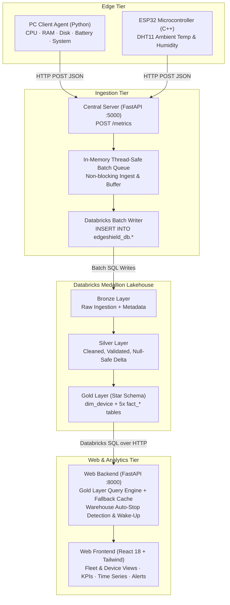

# EdgeShield

> **Edge-to-Lakehouse Telemetry and Intelligent Monitoring Platform**

EdgeShield is an end-to-end edge observability and telemetry system designed to ingest, process, store, and visualize operational metrics from diverse computing endpoints — ranging from multi-core workstations and laptops to embedded Linux nodes and microcontroller hardware (ESP32) — into a Databricks Lakehouse architecture.

---

## What is EdgeShield?

EdgeShield bridges the gap between low-level edge hardware telemetry and enterprise-grade data lakehouse analytics. It continuously collects host resource metrics (CPU, memory, disk, and battery health) along with ambient environmental conditions (temperature and humidity), ingests them through a high-throughput asynchronous server, transforms them across a Databricks Medallion pipeline (Bronze → Silver → Gold star schema), and serves actionable insights through a resilient real-time monitoring dashboard.

---

## Problem It Solves

Traditional observability stacks (such as Prometheus, Grafana, Datadog, or cloud-native metric agents) are optimized for server infrastructure, Kubernetes clusters, and always-on cloud VMs:

* **Edge Heterogeneity:** Microcontrollers (ESP32) and small edge appliances cannot run heavy agent daemons, containers, or full TLS/daemon stacks.
* **Network & Power Volatility:** Edge nodes experience transient connectivity, power constraints, and variable battery discharge rates that server agents ignore.
* **Fragmented Telemetry:** Hardware health, battery degradation, and ambient physical conditions are often stored in disparate silos, preventing unified root-cause correlation.
* **Lack of Historical Analytics & ML Readiness:** Standard metric collectors discard fine-grained history or downsample prematurely, making it difficult to run deep historical data engineering, fleet-wide aggregation, or predictive machine learning models.

EdgeShield provides a unified, lightweight, and scalable path: edge devices post compact JSON payloads over HTTP, a central ingestion layer buffers and writes batches into Databricks, a Medallion ETL pipeline structures the data into an analytics-ready Gold star schema, and an auto-stop resilient web dashboard provides instant visibility.

---

## Key Features

* **Dual Edge Ingestion:**
  * **PC Client Agent:** Modular Python collector (`psutil`, sysfs fallback) capturing CPU utilization and frequencies, RAM allocation, mount-point storage, system uptime, and detailed battery health metrics (charge percentage, power source, design vs. full-charge capacity, and degradation percentage).
  * **ESP32 Microcontroller Node:** Lightweight C++/Arduino firmware sampling ambient temperature and relative humidity via a DHT11 sensor and dispatching HTTP JSON payloads.
* **Asynchronous Central Ingestion Server:**
  * FastAPI ingestion server buffering inbound telemetry in a thread-safe, non-blocking batch queue.
  * Responds immediately (`< 10ms` HTTP 200) to edge nodes to conserve edge power and network sockets.
  * Flushes telemetry in batches to Databricks SQL over a single pooled connection.
* **Databricks Medallion Lakehouse Architecture:**
  * **Bronze Layer:** Raw telemetry landing tables with ingestion timestamps and audit metadata.
  * **Silver Layer:** Cleaned, deduplicated, schema-validated tables with null-safe battery normalization across operating systems.
  * **Gold Layer:** Analytical star schema featuring a central device dimension (`dim_device`) and five decoupled fact tables (`fact_cpu_telemetry`, `fact_ram_telemetry`, `fact_disk_telemetry`, `fact_battery_telemetry`, `fact_environment_telemetry`).
* **Resilient Web Dashboard & Analytics API:**
  * FastAPI backend querying the Databricks Lakehouse Gold layer directly via the Databricks SQL Connector.
  * **Databricks Free Tier Auto-Stop Resiliency:** In-memory fallback cache (3-minute TTL) prevents UI crashes when warehouses sleep, with automatic state classification (`online`, `starting`, `stopped`, `unconfigured`) and a one-click asynchronous wake-up trigger (`POST /api/health/wake-up`).
  * Modern React 18 + Vite + TypeScript + Tailwind CSS user interface with responsive Recharts time-series visualizations, fleet vs. individual device scoping, and rule-based heuristic alerting.
* **Documentation & Presentation Suite:**
  * Comprehensive architecture specifications, academic project report PDF, and an interactive 7-slide Vite-based presentation website embedding a live telemetry workflow simulation.

---

## High-Level Architecture



### Telemetry Lifecycle
1. **Collect:** Edge agents poll hardware registers and sensors at configurable intervals (default: 10s).
2. **Buffer & Ingest:** The Central Ingestion Server receives payloads at `/metrics`, enqueues them in memory, returns `HTTP 200`, and flushes batches into Databricks `edgeshield_db`.
3. **Refine:** Databricks ETL pipelines transform raw records through Bronze landing tables, clean and normalize metrics in Silver, and aggregate them into the Gold star schema.
4. **Serve & Visualize:** The Web Backend queries the Gold layer, serves REST endpoints (`/api/devices`, `/api/kpis`, `/api/timeseries`, `/api/alerts`, `/api/health`), and the React Frontend renders real-time telemetry charts and alerts.

---

## Repository Structure

```
EdgeShield/
├── client/                      # Modular PC telemetry agent (Python)
│   ├── collectors/              # Individual collectors (battery, cpu, disk, ram, system)
│   ├── client.py                # Main collection loop and HTTP transmission agent
│   ├── config.py                # Client configuration and environment loader
│   └── .env.example             # Client environment template
├── server/                      # Central ingestion server (FastAPI)
│   ├── routes/                  # Ingestion endpoints (POST /metrics)
│   ├── server.py                # Server entrypoint and lifespan management
│   ├── database.py              # In-memory batch queue and Databricks writer
│   ├── config.py                # Server settings & connection credentials
│   └── .env.example             # Server environment template
├── firmware/                    # Microcontroller firmware (C++ / Arduino)
│   └── esp32_dht11.ino          # ESP32 firmware for DHT11 environmental sensing
├── edgeshield_etl_pipeline/     # Databricks Lakehouse transformations
│   ├── ddl/                     # Catalog and schema DDL notebooks
│   └── transformations/         # Medallion ETL scripts (Bronze, Silver, Gold)
├── web/                         # Full-stack monitoring dashboard
│   ├── backend/                 # FastAPI analytical backend querying Gold layer
│   │   ├── app/                 # Routers, Databricks service, alert engine, config
│   │   └── requirements.txt     # Python backend dependencies
│   ├── frontend/                # React 18 + Vite + TypeScript dashboard
│   │   ├── src/                 # Components, pages, hooks, services, types
│   │   └── package.json         # Node.js frontend dependencies
│   └── README.md                # Web workspace guide
├── doc/                         # Documentation, project report, and presentation
│   ├── presentation/            # Interactive 7-slide React presentation app
│   ├── EdgeShield_Project_Report.pdf # Formal engineering report
│   └── README.md                # Documentation guide
├── requirements.txt             # Root Python dependencies (client, server, ETL tests)
└── README.md                    # Root project documentation (this file)
```

---

## Quick Start

### 1. Central Ingestion Server
The ingestion server receives telemetry from edge nodes and batches records into Databricks.

```bash
# Navigate to server directory
cd server

# Create and configure .env
cp .env.example .env
# Edit .env with your Databricks workspace credentials

# Install root dependencies (if not already installed)
pip install -r ../requirements.txt

# Run the ingestion server (default port: 5000)
python server.py
```
*Health check:* Verify the server is running at [http://localhost:5000](http://localhost:5000).

---

### 2. PC Client Agent
The PC client agent gathers host metrics and transmits them to the ingestion server.

```bash
# Navigate to client directory
cd client

# Create and configure .env
cp .env.example .env
# Edit .env to set SERVER_IP, SERVER_PORT, and optional DEVICE_ID override

# Run the client agent
python client.py
```
By default, the client gathers system, CPU, memory, disk, and battery metrics every 10 seconds and transmits them to `http://<SERVER_IP>:5000/metrics`.

---

### 3. ESP32 Environmental Firmware
The ESP32 node collects ambient temperature and humidity and posts telemetry over Wi-Fi.

1. Open `firmware/esp32_dht11.ino` in the **Arduino IDE** or **PlatformIO**.
2. Install required Arduino libraries:
   * `DHT sensor library` (Adafruit)
   * `Adafruit Unified Sensor`
   * `ArduinoJson` (v6 or v7)
3. Connect the DHT11 data pin to GPIO 4 (pin `D4`) on your ESP32 board.
4. Update the Wi-Fi credentials and target ingestion server URL in `esp32_dht11.ino`:
   ```cpp
   const char* WIFI_SSID  = "YOUR_WIFI_SSID";
   const char* WIFI_PASS  = "YOUR_WIFI_PASSWORD";
   const char* SERVER_URL = "http://<SERVER_IP>:5000/metrics";
   ```
5. Select **ESP32 Dev Module**, choose your serial COM port, compile, and upload. Open the Serial Monitor at `115200` baud to observe sensor readings and transmission logs.

---

### 4. Web Dashboard & Analytics API

#### Start the Backend API
```bash
# Navigate to web backend directory
cd web/backend

# Create and configure .env
cp .env.example .env
# Configure Databricks host, HTTP path, token, catalog, and schema

# Install backend dependencies
pip install -r requirements.txt

# Start FastAPI server on port 8000
uvicorn app.main:app --reload --port 8000
```
Interactive API documentation will be available at [http://localhost:8000/docs](http://localhost:8000/docs).

#### Start the Frontend UI
```bash
# Open a new terminal and navigate to web frontend directory
cd web/frontend

# Install dependencies (Node.js 18+)
npm install

# Start the Vite development server (port 5173)
npm run dev
```
Open your browser to [http://localhost:5173](http://localhost:5173). The Vite dev server automatically proxies `/api` calls to the FastAPI backend running on port 8000.

---

## Configuration & Environment Variables

| Component | Variable | Required | Default | Description |
| :--- | :--- | :---: | :--- | :--- |
| **Server** | `HOST` | No | `0.0.0.0` | Host IP address to bind server socket |
| **Server** | `PORT` | No | `5000` | Ingestion server listening port |
| **Server** | `DATABRICKS_HOST` | **Yes** | — | Databricks workspace host (`dbc-xxxx.cloud.databricks.com`) |
| **Server** | `DATABRICKS_HTTP_PATH` | **Yes** | — | SQL Warehouse HTTP Path (`/sql/1.0/warehouses/xxxx`) |
| **Server** | `DATABRICKS_TOKEN` | **Yes** | — | Databricks Personal Access Token (`dapi...`) |
| **Client** | `SERVER_IP` | **Yes** | `127.0.0.1` | IP address of central ingestion server |
| **Client** | `SERVER_PORT` | No | `5000` | Port of central ingestion server |
| **Client** | `SERVER_ENDPOINT` | No | `/metrics` | Target ingestion endpoint route |
| **Client** | `DEVICE_ID` | No | `PC-<hostname>` | Unique device identifier override |
| **Client** | `SAMPLING_INTERVAL_SECONDS` | No | `10` | Sampling cadence in seconds |
| **Web Backend** | `DATABRICKS_HOST` | **Yes** | — | Databricks workspace host |
| **Web Backend** | `DATABRICKS_HTTP_PATH` | **Yes** | — | SQL Warehouse HTTP Path |
| **Web Backend** | `DATABRICKS_TOKEN` | **Yes** | — | Databricks Personal Access Token |
| **Web Backend** | `DATABRICKS_CATALOG` | No | `edgeshield_lakehouse` | Unity Catalog catalog name |
| **Web Backend** | `DATABRICKS_SCHEMA` | No | `gold` | Schema containing Gold star schema tables |
| **Web Backend** | `PORT` | No | `8000` | Web API listening port |
| **Web Backend** | `CACHE_TTL_SECONDS` | No | `180` | In-memory fallback query cache TTL |
| **Web Backend** | `QUERY_TIMEOUT_SECONDS` | No | `45` | Databricks SQL query execution timeout |
| **Web Backend** | `CORS_ORIGINS` | No | `http://localhost:5173,...` | Allowed CORS origins (comma-separated) |

---

## Current V1 Limitations

* **Plaintext HTTP Transmission:** Edge clients communicate over standard HTTP without mutual TLS (mTLS) or per-device signature tokens.
* **In-Memory Volatility:** Ingestion server batch queues and web backend query caches reside strictly in process memory; process restarts drop pending unwritten batches.
* **Databricks SQL Cold Starts:** When using Databricks Free Tier or Serverless SQL Warehouses that auto-stop on idle, initial queries after sleep take 15–45 seconds to spin up compute (handled gracefully by the UI cache and wake-up button).
* **Ephemeral Alert Acknowledgments:** Acknowledged alerts in the Web Dashboard are tracked in backend memory rather than persisted to a database or Delta table.
* **Static Firmware Configuration:** The ESP32 firmware relies on hardcoded Wi-Fi credentials and ingestion URLs defined at compile time.

---

## Roadmap

### V1.1 (Production Hardening)
* **Ingestion Security:** HTTPS/TLS endpoint enforcement and shared-secret or token authentication (`X-Device-Token`) per edge device.
* **Offline Client Spooling:** Local SQLite or file-based dead-letter spool on the PC client to prevent telemetry loss during network disconnects.
* **Persistent Alert Lifecycle:** Persist alert state, acknowledgments, and rule history directly in a Delta table.
* **Dynamic ESP32 Provisioning:** Implement a captive portal (e.g. WiFiManager) for on-device network and ingestion URL configuration without re-flashing.

### V2 (Intelligence & Advanced Operations)
* **Machine Learning & Anomaly Detection:** Deploy Databricks MLflow models to perform multivariate anomaly detection (e.g., Isolation Forests) across CPU, memory, and temperature spikes.
* **Predictive Battery Health:** Battery cycle degradation forecasting using historical charge/discharge telemetry.
* **Bidirectional Control Channel:** WebSockets or MQTT command plane allowing operators to adjust device sampling intervals or trigger edge self-tests remotely.
* **Natural Language Lakehouse Queries:** Conversational AI query assistant integrated into the dashboard to analyze fleet telemetry using natural language.

---

## License

This project is licensed under the [MIT License](https://opensource.org/licenses/MIT).

