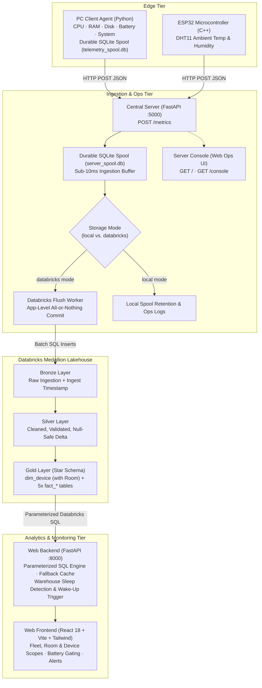

# EdgeShield

> **Edge-to-Lakehouse Telemetry and Intelligent Monitoring Platform**  
> *Production-hardened observability for heterogeneous edge computing and Databricks Lakehouse analytics.*

---

## What is EdgeShield?

EdgeShield is an edge-to-lakehouse observability platform that collects, buffers, and analyzes hardware health and environmental telemetry from heterogeneous computing endpoints — including multi-core workstations, laptops, embedded Linux systems, and ESP32 microcontrollers — into a Databricks Medallion Lakehouse architecture. The platform combines a lightweight, offline-resilient edge client with a dual-mode ingestion server featuring local durable spooling, a Medallion Star Schema on Databricks, and an operational web dashboard equipped with physical room filtering, battery capability gating, and SQL injection protections.

---

## The Problem & The Solution

### The Challenge of Edge Observability
Traditional infrastructure monitoring frameworks (such as Prometheus, Grafana, Datadog, or cloud VM agents) were engineered for continuous cloud connectivity, homogeneous server hardware, and containerized microservices:
* **Hardware Heterogeneity:** Edge fleets mix stationary workstations, battery-powered field laptops, and low-power microcontrollers (ESP32) that cannot run heavy agent daemons or complex network stacks.
* **Network & Power Volatility:** Field endpoints experience intermittent Wi-Fi, cellular dropouts, and power cycling. Standard metric agents drop unacknowledged packets during network disconnects.
* **Fragmented Telemetry Silos:** Compute resource utilization, battery degradation, and ambient physical conditions (temperature/humidity) are typically stored in separate tools, hindering unified root-cause analysis.
* **Premature Aggregation:** Metric forwarders often downsample telemetry at ingest time, discarding raw event resolution necessary for long-term fleet analytics, predictive maintenance, and machine learning.

### The EdgeShield Solution
EdgeShield establishes a unified, fault-tolerant telemetry pipeline designed specifically for edge operational realities:
1. **Local-First Durability:** Dual-stage SQLite spooling on both edge clients and the central ingestion server buffers telemetry during disconnections and flushes in FIFO batches upon reconnection.
2. **App-Level All-or-Nothing Cloud Sync:** Ingestion server writes to Databricks SQL landing tables guarantee delivery before spool purging. Workspace/Hive landing tables do not support multi-statement database transactions (`TRANSACTION_NOT_SUPPORTED.WRITE_NON_CATALOG_MANAGED_TABLE`); durability is guaranteed at the application level by deleting spool records only after all constituent table inserts for a payload succeed.
3. **Medallion Star Schema:** Databricks Delta Lake organizes raw events into Bronze landing tables, validates and cleans records in Silver, and projects analytical facts and a room-aware device dimension (`dim_device`) in Gold.
4. **Context-Aware Monitoring:** The dashboard automatically adapts to device capabilities — suppressing battery indicators for stationary desktops, segmenting fleet health by physical room, and maintaining responsiveness during cloud warehouse sleep cycles.

---

## System Architecture



### Telemetry Lifecycle
1. **Edge Sampling & Client Spooling:** Edge agents sample system and ambient sensors at regular intervals (default: 10s). Records are committed to local SQLite before transmission over HTTP.
2. **Immediate Server Buffering:** The Central Ingestion Server receives payloads at `POST /metrics`, records client IP and metadata in the in-memory device registry, commits to `server_spool.db`, and returns `HTTP 200` in `< 10ms`.
3. **Storage Mode & Cloud Ingestion:**
   - In **`local` mode**, telemetry remains safely buffered on the server host for local pilots and testing without cloud accounts.
   - In **`databricks` mode**, the background worker executes multi-table inserts into Databricks SQL. Records are deleted from the local spool only after all constituent table inserts for that payload succeed.
4. **Lakehouse Refinement:** Medallion pipelines process raw landing tables through Silver validation to Gold star schema tables (`dim_device`, `fact_cpu_telemetry`, `fact_ram_telemetry`, `fact_disk_telemetry`, `fact_battery_telemetry`, `fact_environment_telemetry`).
5. **Analytical Visualization:** The Web Backend runs parameterized queries against the Gold layer, serving the React dashboard with sub-second KPI aggregation, time series charting, and room-scoped fleet analysis.

---

## Key Capabilities

### 1. Dual-Stage Durable Spooling & Zero-Loss Ingest
- **Edge Resilience:** If the server is offline or unreachable, the client buffers telemetry in a local SQLite database (`telemetry_spool.db`). Once restored, pending records drain automatically.
- **Server Resilience:** The central server commits inbound payloads to `server_spool.db` before cloud transmission. If Databricks is unreachable or suspended, telemetry accumulates safely on disk.
- **App-Level All-or-Nothing Durability:** Because workspace and Hive metastore landing tables do not support multi-statement SQL transactions, durability is enforced at the application level: spool records are purged only after every insert for that payload succeeds. On any error, records are retained in the spool for retry.

### 2. Dual Storage Modes (Local Pilot vs. Databricks Lakehouse)
- **Runtime Mode Switcher:** Operators can toggle between `local` and `databricks` storage modes via the Server Console UI or REST API (`POST /api/console/storage-mode`).
- **Zero-Cloud Local Pilots:** In `local` mode, teams can evaluate edge client deployments, device discovery, and ingestion performance without configuring Databricks credentials.

### 3. Physical Room Dimension (Location Segmentation)
- **Full-Stack Location Tracking:** Clients declare an optional physical room tag (`ROOM=Lab-A`). The tag flows through ingestion landing tables, Silver cleaning, and into the Gold `dim_device` dimension.
- **Dashboard Room Filtering:** Operators can filter the dashboard by individual room or view the entire fleet, scoping device lists, KPIs, and time-series charts to that specific physical area.

### 4. Battery-Aware Intelligence
- **Hardware-Adaptive Telemetry:** The client agent detects battery presence (`battery.present: true` on laptops; `false` on stationary desktops and servers). Stationary machines pass normalized `null` fields, preventing schema errors.
- **Dynamic UI Suppression:** The web dashboard inspects device capabilities and automatically suppresses the Battery KPI card and "Power & Battery" chart for desktop machines, preventing false-positive low-battery alerts.

### 5. Parameterized SQL & Defense-in-Depth Security
- **Strict Query Parameterization:** The analytical backend passes all dynamic values (`:device_id`, `:device_key`, `:room`, `:from_ts`, `:to_ts`, `:window_ts`) through parameterized query markers.
- **Allowlist & Type Enforcement:** Identifiers and room strings are validated against strict alphanumeric regexes; timestamps are parsed strictly as ISO-8601; metrics and grains are selected exclusively from immutable static dictionaries.

---

## Quick Start

### 1. Central Ingestion Server & Server Console
The ingestion server receives telemetry from edge nodes and manages batch synchronization to Databricks.

```bash
# Navigate to server directory
cd server

# Install dependencies (Python 3.11+)
pip install -r requirements.txt

# Configure environment (Databricks credentials optional for local mode)
cp .env.example .env

# Start server (default: port 5000)
python server.py
```
* **Landing Page:** [http://localhost:5000](http://localhost:5000)
* **Server Console:** [http://localhost:5000/console](http://localhost:5000/console) (Overview, Device Registry, Spool Controls, and Logs)

---

### 2. PC Client Agent
The modular Python agent runs on endpoints, collects hardware telemetry, and spools records locally.

```bash
# Navigate to client directory
cd client

# Recommended: Guided Interactive Setup (auto-configures venv, room tag, and auto-start)
# On Linux/macOS:
bash install/setup.sh
# On Windows (PowerShell):
powershell -ExecutionPolicy Bypass -File install\setup.ps1

# Alternatively, manual run:
pip install -r requirements.txt
cp .env.example .env
# Edit .env with SERVER_IP, optional ROOM, and DEVICE_ID
python client.py
```

---

### 3. ESP32 Microcontroller Node
Samples ambient temperature and humidity via a DHT11 sensor and posts JSON over Wi-Fi.

1. Open `firmware/esp32_dht11.ino` in the Arduino IDE or PlatformIO.
2. Install required libraries: `DHT sensor library` (Adafruit), `Adafruit Unified Sensor`, and `ArduinoJson`.
3. Set your Wi-Fi SSID, password, and server URL (`http://<SERVER_IP>:5000/metrics`).
4. Connect DHT11 data pin to GPIO 4 (`D4`) on your ESP32 board and flash the firmware.

---

### 4. Web Dashboard & Analytics Backend

#### Start Backend API
```bash
# Navigate to web backend directory
cd web/backend

# Install dependencies
pip install -r requirements.txt

# Configure .env with Databricks SQL Warehouse credentials
cp .env.example .env

# Run backend service (port 8000)
uvicorn app.main:app --reload --port 8000
```
*Swagger API Documentation:* [http://localhost:8000/docs](http://localhost:8000/docs)

#### Start Frontend UI
```bash
# Open a new terminal and navigate to frontend directory
cd web/frontend

# Install Node dependencies (Node.js 18+)
npm install

# Start Vite development server (port 5173)
npm run dev
```
Open [http://localhost:5173](http://localhost:5173). The UI connects to the backend API via Vite proxy.

---

## Component Map

| Component | Path | Description | Tech Stack | Primary Documentation |
| :--- | :--- | :--- | :--- | :--- |
| **PC Client Agent** | [`client/`](client/) | Endpoint telemetry agent with offline SQLite spool and auto-start service installers | Python 3.11+, `psutil`, SQLite3 | [`client/README.md`](client/README.md) |
| **Ingestion Server** | [`server/`](server/) | High-throughput ingestion, durable spooling, storage modes, and Server Console ops UI | FastAPI, SQLite3, Databricks SQL | [`server/README.md`](server/README.md) |
| **Microcontroller Firmware** | [`firmware/`](firmware/) | Environmental sensor sampling (DHT11 temp/humidity) and HTTP dispatch | C++, Arduino, ESP32 | [`firmware/esp32_dht11.ino`](firmware/esp32_dht11.ino) |
| **Lakehouse Pipeline** | [`edgeshield_etl_pipeline/`](edgeshield_etl_pipeline/) | Medallion DDL notebooks and transformation logic (Bronze → Silver → Gold) | Databricks SQL, Delta Lake, PySpark | [`edgeshield_etl_pipeline/`](edgeshield_etl_pipeline/) |
| **Web Backend** | [`web/backend/`](web/backend/) | Analytical REST API querying Gold star schema with query cache and auto-stop wake-up | FastAPI, `databricks-sql-connector` | [`web/README.md`](web/README.md) |
| **Web Frontend** | [`web/frontend/`](web/frontend/) | Interactive monitoring dashboard with fleet/room filters and battery capability gating | React 18, Vite, TypeScript, Tailwind | [`web/README.md`](web/README.md) |
| **Presentation Suite** | [`doc/presentation/`](doc/presentation/) | Standalone 7-slide interactive presentation application with live workflow simulation | React, TypeScript, Vite | [`doc/presentation/README.md`](doc/presentation/README.md) |
| **Pilot Specifications** | [`docs/`](docs/) | External reviewer evaluation brief, technical limitations, and pilot runbooks | Markdown | [`docs/PILOT_AND_LIMITATIONS.md`](docs/PILOT_AND_LIMITATIONS.md) |

---

## Pilot & Operational Boundaries

For full technical specifications for external reviewers, consult [**docs/PILOT_AND_LIMITATIONS.md**](docs/PILOT_AND_LIMITATIONS.md).

* **Authentication Model:** In the current release, edge clients communicate over unauthenticated HTTP JSON, and the dashboard provides open monitoring access. For pilots, deployments should reside within a trusted LAN, VLAN, or behind a reverse proxy (e.g. NGINX with Basic Auth). Multi-tenant user auth and mTLS / device tokens are planned for v2.
* **Databricks Free Tier Auto-Stop:** On Serverless or Free Tier SQL Warehouses that sleep during inactivity, initial queries after idle periods experience a 15–45 second spin-up latency. The web application mitigates this with an in-memory fallback cache (3-minute TTL) and a one-click **"Wake Up Warehouse"** button.
* **Gold Room Schema Migration:** Environments upgrading from pre-v1.1 schemas require adding `room STRING` to `system_metrics` landing tables. Rebuilding `dim_device` from historical data populates room assignments for legacy devices.

---

## Project Roadmap

| Capability / Phase | v1.0 (Foundation) | v1.1 Hardening (Current) | v2 (Enterprise & Intelligence) |
| :--- | :---: | :---: | :---: |
| **Edge Hardware Telemetry** | CPU, RAM, Disk, Battery, ESP32 Temp/Humidity | Same + Battery presence detection & safe nulls | GPU metrics, fan speed, network I/O counters |
| **Edge Offline Spooling** | In-memory only (lost on process exit) | **Durable SQLite spool (`telemetry_spool.db`)** | Dynamic bandwidth-throttled backoff |
| **Server Ingestion Buffer** | In-memory batch queue | **Durable SQLite spool (`server_spool.db`)** | Distributed message broker (Kafka / Event Hub) |
| **Cloud Synchronization** | Non-transactional batch writes | **App-level all-or-nothing spool purge per payload** | Delta Live Tables streaming ingestion |
| **Server Storage Modes** | Databricks only | **`local` (zero-cloud pilot) vs. `databricks`** | Hybrid tiered replication |
| **Server Control Plane** | Raw `/` JSON status | **Server Console UI (`/` & `/console`) + REST APIs** | Centralized fleet configuration management |
| **Physical Room Dimension** | Not supported | **Full-stack room tagging (`dim_device` & UI filter)** | Multi-facility hierarchical topology |
| **Battery Intelligence** | Always assumed battery present | **Per-device capability gating & alert suppression** | Predictive battery degradation forecasting |
| **SQL Security** | String interpolation | **Strict parameterized queries & allowlist validation** | Role-based column masking & Unity Catalog RBAC |
| **Alert Engine** | In-memory heuristic rules | In-memory heuristic rules + battery gating | **Delta-persisted alert state & ML anomaly detection** |
| **Device Authentication** | None (Plaintext HTTP) | None (Internal LAN / VPN pilot topology) | **Mutual TLS (mTLS) & Per-Device API Tokens** |

---

## License

EdgeShield is released under the [MIT License](LICENSE).
